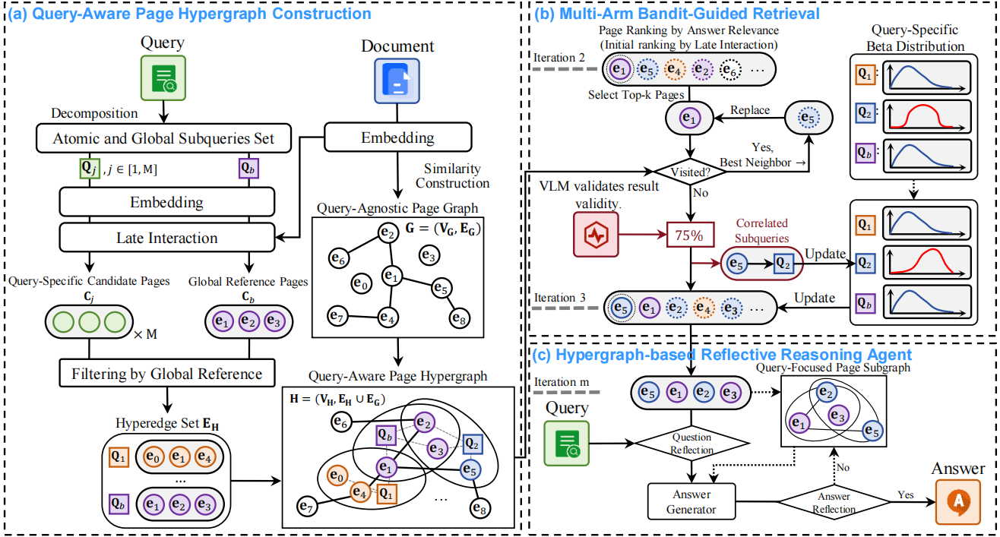

# MAB-DQA: Addressing Query Aspect Importance in Document Question Answering with Multi-Armed Bandits

> #### ACL 2026 (Main Conference🚀) | [📄 Paper](https://arxiv.org/pdf/2604.08952)

## 📌 Update Log & Roadmap

| Date       | Status | Description                                                                 |
|------------|--------|-----------------------------------------------------------------------------|
| 2026-11-18 | ✅     | Same pipeline on macOS (Apple GPU) and Linux (CUDA): shared uv lockfile, portable checkpoint path |
| 2026-11-17 | ✅     | Migrated environment setup from conda to uv with Python 3.13 |
| 2026-06-26 | ✅     | Fixed path initialization error in `fast_run.py` when config path is not correctly configured |
| 2026-06-26 | ✅     | Fixed page index offset bug of ColPali retriever on multi-page PDF documents |
| TBD        | ⏳     | Complete code refactoring of Question Answering module and full open-source release |
| TBD        | ⏳     | Adapt low-memory inference mode for lightweight deployment                  |

## Overview

> **Abstract:** \
Document Question Answering (DQA) involves generating answers from a document based on a user’s query, representing a key task in document understanding.
This task requires interpreting visual layouts, which has prompted recent studies to adopt multimodal Retrieval-Augmented Generation (RAG) that processes page images for answer generation. However, in multimodal RAG, visual DQA struggles to utilize a large number of images effectively, as the retrieval stage often retains only a few candidate pages (e.g., Top‑4), causing informative but less visually salient content to be overlooked in favor of common yet low-information pages.To address this issue, we propose a Multi-Armed Bandit–based DQA framework (MAB-DQA) to explicitly model the varying importance of multiple implicit aspects in a query.Specifically, MAB-DQA decomposes a query into aspect-aware subqueries and retrieves an aspect-specific candidate set for each.It treats each subquery as an arm and uses preliminary reasoning results from a small number of representative pages as reward signals to estimate aspect utility.Guided by an exploration–exploitation policy, MAB-DQA dynamically reallocates retrieval budgets toward high-value aspects. With the most informative pages and their correlations, MAB-DQA generates the expected results.



## 🐹 Installation

This repository uses [uv](https://docs.astral.sh/uv/) with `Python 3.13`. One lockfile (`uv.lock`) covers both supported machines. The models, prompts, and bandit loop are the same as the paper. Only the device changes:

| Machine | PyTorch wheel from the lockfile | Retriever | VLM |
| --- | --- | --- | --- |
| Linux x86_64 with NVIDIA GPUs | `torch==2.8.0` built for CUDA 12.8 | `cuda:0` | `device_map: auto` (the paper's setting; uses the visible GPUs) |
| macOS Apple silicon | `torch==2.8.0` with Apple's GPU | `mps` | `device_map: auto` (lands on `mps`) |

On a machine with no GPU, both fall back to CPU. On macOS, operations Apple's GPU does not implement fall back to CPU (`PYTORCH_ENABLE_MPS_FALLBACK=1`, set by the entry scripts). Scores can differ slightly from a CUDA run when that happens. The retrieved pages and the scoring formula stay the ones in the paper.

Make sure uv is installed (`curl -LsSf https://astral.sh/uv/install.sh | sh`).

1. Clone this repository and navigate to `MAB-DQA`

```bash
git clone https://github.com/MyLabs-LLC/MAB-DQA.git
cd MAB-DQA
```

2. Install. `uv sync` picks the wheel for the machine you are on.

```bash
uv sync
source .venv/bin/activate
```

`./setup_env.sh` does the same thing and, unless `UV_DEFAULT_INDEX` is already set, first picks the faster of the Tsinghua mirror and PyPI. You can also prefix commands with `uv run` instead of activating `.venv`.

To use a different CUDA build on Linux, point uv at that [PyTorch index](https://docs.astral.sh/uv/guides/integration/pytorch/). Add packages with `uv add`, not `pip install`. Restrict GPUs with `CUDA_VISIBLE_DEVICES` before launching; the scripts no longer pin a lab-specific GPU id.

## 🤖 Model Checkpoints

Download the two models the retrieval script loads. The directory names have to match `configs/model/`. `uv run --env-file .env` picks up `HF_TOKEN` if you keep one in `.env` (that file is gitignored).

```bash
uv run hf download vidore/colpali-v1.3-merged --local-dir checkpoints/Colpali
uv run hf download Qwen/Qwen2.5-VL-7B-Instruct --local-dir checkpoints/Qwen2.5-VL-7B-Instruct
```

The following table provides direct links to the Hugging Face repositories for each model checkpoint:

| Model Name                   | Hugging Face Location                                                             |
| ---------------------------- |-----------------------------------------------------------------------------------|
| colbertv2.0                  | [colbert-ir/colbertv2.0](https://huggingface.co/colbert-ir/colbertv2.0)           |
| colpali-v1.3-merged          | [vidore/colpali-v1.3-merged](https://huggingface.co/vidore/colpali-v1.3-merged)   |
| MoLoRAG-QwenVL-3B            | [xxwu/MoLoRAG-QwenVL-3B](https://huggingface.co/xxwu/MoLoRAG-QwenVL-3B)           |
| Qwen2.5-VL-7B-Instruct       | [Qwen/Qwen2.5-VL-7B-Instruct](https://huggingface.co/Qwen/Qwen2.5-VL-7B-Instruct) |
| Qwen3-VL-32B-Instruct        | [Qwen/Qwen3-VL-32B-Instruct](https://huggingface.co/Qwen/Qwen3-VL-32B-Instruct)   |

The other rows are optional checkpoints used by other configs. Put each one in `checkpoints/` under the directory name that config's `model_path` expects.

## 🎯 Fast Run

From the repository root, with the checkpoints below on disk:

```bash
# Linux (CUDA). Add CUDA_VISIBLE_DEVICES=0 to keep the VLM on one GPU.
python src/retrieval_mab.py

# macOS. The script enables the Apple-GPU CPU fallback itself.
python src/retrieval_mab.py

# One PDF, no dataset. Same models and top-10 budget as the paper's fast run.
python fast_run.py
```

`checkpoints_path` in `configs/model/base.yaml` resolves to this repository's `checkpoints/` directory on either machine. Run the commands from the repository root so `datasets/` and `results/` resolve as well.

```
from src.tools.close_domain_dqa.mab_retrieval_tools import MABRetrieverTools

if __name__ == "__main__":
    retriever = MABRetrieverTools(
        retriever="colpali/colpali-1.3",
        vlm="qwen/qwen25vl-7b",
        top_k=10,
    )
    
    pdf_path = "examples/example.pdf"
    question = "what is total current assets in FY2023 for Bestbuy? Answer in million."
    
    pages, scores = retriever.retrieve(pdf_path, question)

```

## 🐼 Prepare Dataset

Run the script below after `setup_env.sh`. It downloads the [Mdocagent dataset](https://huggingface.co/datasets/Lillianwei/Mdocagent-dataset) into `datasets/` using the faster of huggingface.co and hf-mirror.com:

```bash
chmod +x setup_dataset.sh
./setup_dataset.sh              # all datasets
./setup_dataset.sh MMLongBench  # or only the ones you need
```

Each dataset ends up as `datasets/<name>/samples.json` plus `datasets/<name>/documents/*.pdf`. Set `HF_ENDPOINT` to skip the speed test.

## 🐣 Retrieval

Run the following command:
```bash
uv run python src/retrieval_mab.py
```

The inference results will be saved to:  
```
results/<mission>/<dataset>/sample<suffix>.json
```


## 🐧 Question Answering

**#TODO** The code refactoring is currently underway, and I will intensify the refactoring in the following parts

## 🐸 Evaluation

1. Add your OpenAI API key in `config/model/openai/gpt-4o.yaml`.

2. Run `uv run python src/eval_rag.py`.

3. Run `uv run python src/eval_qa.py`.

## 🐭 Citation

You are encouraged to modify/distribute this code. However, please acknowledge this code and cite the paper appropriately.

```bibtex
@inproceedings{xiang-etal-2026-mab,
    title = "{MAB}-{DQA}: Addressing Query Aspect Importance in Document Question Answering with Multi-Armed Bandits",
    author = "Xiang, Yixin  and
      Ma, Yunshan  and
      Du, Xiaoyu  and
      Chen, Yibing  and
      Zhang, Yanxin  and
      Tang, Jinhui",
    editor = "Liakata, Maria  and
      Moreira, Viviane P.  and
      Zhang, Jiajun  and
      Jurgens, David",
    booktitle = "Proceedings of the 64th Annual Meeting of the {A}ssociation for {C}omputational {L}inguistics (Volume 1: Long Papers)",
    month = jul,
    year = "2026",
    address = "San Diego, California, United States",
    publisher = "Association for Computational Linguistics",
    url = "https://aclanthology.org/2026.acl-long.1053/",
    doi = "10.18653/v1/2026.acl-long.1053",
    pages = "22973--22992",
    ISBN = "979-8-89176-390-6",
}
```

---
